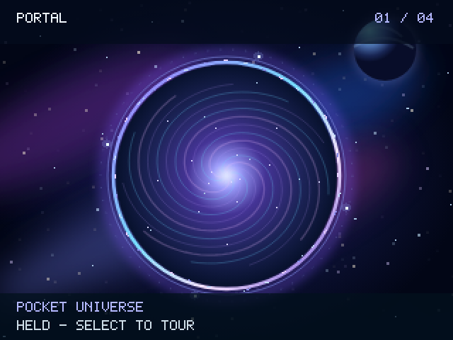
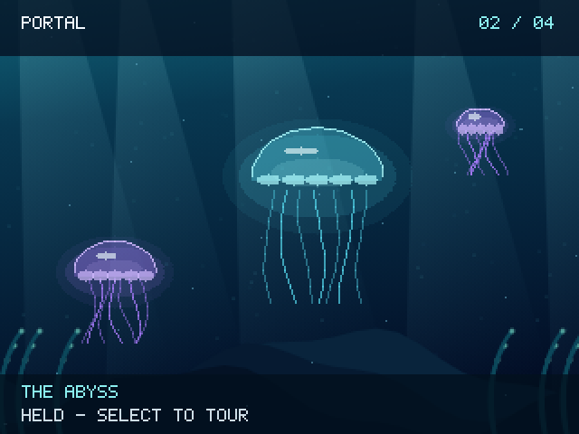
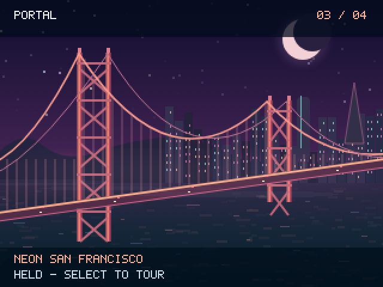
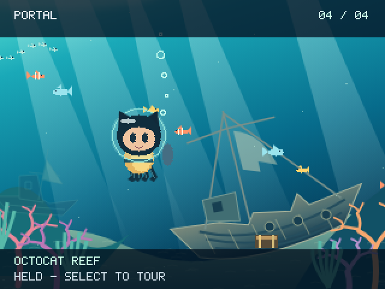

# Portal for the GitHub Universe Badge

Four living worlds in your pocket. A silent, offline scene player with original
backgrounds, moving particles, hidden surprises and optional white case lights.

**Pocket Universe → The Abyss → Neon San Francisco → Octocat Reef**

Watch a nebula and passing comet, luminous jellyfish, Golden Gate traffic and fog,
or an Octocat diver among coral and a shipwreck. The automatic tour changes worlds
every 28 seconds by default. Hold a favorite world without freezing its animation,
or trigger its surprise with a button. No account, network, agenda or other app
is required.

## Four worlds to explore

| Pocket Universe | The Abyss |
| --- | --- |
|  |  |
| **Neon San Francisco** | **Octocat Reef** |
|  |  |

Simulator screenshots rendered from the included app code at 2× its native
320 × 240 resolution. Each is a moment from an animated scene. Holding a world
keeps its animation running.

## Install in five steps

You need a **GitHub Universe 2026 Badger 2350 badge**, its supplied firmware and a
USB cable that carries data. No firmware flashing or Python installation is
needed for the direct-folder method.

1. Download this repository using **Code → Download ZIP**, then extract it.
2. Open the badge's supplied **USB Disk / Mass Storage** app and connect USB.
   A drive named **BADGER** should appear. Copy its current contents somewhere
   safe before making changes.
3. Open the extracted repository's `apps` folder. Copy only **`portal`** into
   **`BADGER/apps/`**. Keep the whole folder, including `__init__.py`, modules,
   icon and assets. The final path must be:

   ```text
   BADGER/
   └── apps/
       └── portal/
           ├── __init__.py
           ├── core.py
           └── ...all other supplied files
   ```

4. Wait for copying to finish, safely eject **BADGER**, then reset/restart the
   badge normally.
5. Open **Portal** from the supplied launcher.

**Keep every existing stock app and file.** Do not replace `main.py`, format the
drive, flash a UF2, or touch `secrets.py`, Wi-Fi credentials or stock settings.
Do not copy this repository's README, tests or tools onto the badge. If your USB
volume has a different layout, stop and inspect its existing apps location rather
than creating a guessed second system tree.

### Updating, rolling back and removing

Before an update, copy any existing `apps/portal/` folder off the badge. Replace
only that custom app folder. Its saved scene and display preferences remain in
the badge's separate state storage.

To roll back, restore the previous custom app folder. To uninstall, remove only
`apps/portal/`. Neither action requires changing the stock launcher or secrets.
Save data lives outside the app folder in `/state/` and may not be exposed on the
USB drive. Do not delete saves unless you intentionally want to reset progress.
Wait at least two seconds after changing settings, or use Home to save before
removing power. USB removal is safe after the host has finished copying/ejecting.

## Controls and everyday use

| Control | Action |
| --- | --- |
| Select | Hold the current world; press again to resume the tour |
| Left / Right | Previous / next world |
| Up | Trigger a surprise |
| Down | Open settings |
| Home | Save and return to the supplied launcher |

In settings, Up/Down selects a row and Select changes it. Choose case-light
brightness, tilt on/off and scene duration (18, 28 or 45 seconds). The tour pauses
in settings. Holding a world keeps its animation running.

The four case LEDs are white. Low is the default, and light output dims further
below 20% battery. Choose Off for no case lighting. Portal has no session reminders
and does not change Fallout or Trail's settings. Automatic ECO mode is currently
a Fallout feature, not a Portal feature.

## Build and test from source

Python 3.9+ is needed only for local development and packaging. No external Python
dependencies are required:

```sh
python3 -m unittest discover -s tests -v
python3 build.py
```

The build creates `dist/portal-badge.zip` with only the allowlisted app, install
instructions, screenshots and linked documentation. Extract it and copy
`apps/portal` using the steps above. Personal configuration, credentials and
save files are excluded from the build allowlist.
Keep the documentation and screenshots with the download for reference. Copy
only the app folder to the badge.

Runtime code lives in `apps/portal/`; portable logic is in `core.py`. The app is
self-contained and does not require either of the other two custom apps. Stock
firmware is a device prerequisite and is deliberately not redistributed here.

## Compatibility and troubleshooting

The runtime was exercised on the delivered Universe 2026 Badger 2350, with its
stock MonaOS 4.0 launcher and MicroPython 1.29.0-preview firmware build
`v1.14-6911.g2e1a6ab1ed.dirty`. The sanitized repository's defaults and build are
also tested locally. Older badges and other firmware versions are not verified.

- **No BADGER drive:** use a data-capable cable and open USB Disk / Mass Storage.
- **App missing:** check the exact folder path above; avoid double-nested folders.
- **Blank screen or import error:** verify every module and asset was copied,
  safely eject and restart. Keep the traceback if you need help diagnosing it.
- **Unexpected settings after an update:** saved preferences are intentionally
  preserved and may differ from fresh-install defaults.
- **No colored case lights:** the badge's case LEDs are white; screen colors are
  unrelated. Check the app's brightness/decorative-light settings.

The download contains this custom app, generic defaults, tests and documentation.
Stock firmware, personal agendas, credentials, device backups and browser sessions
are excluded.

## Credits and maintenance

**Created with AI by DChevrier1.** See [NOTICE.md](NOTICE.md) for artwork, map and
trademark provenance. This is an unofficial custom app, not an official firmware
release. Third-party artwork and marks retain their owners' rights.

For each change, update the README and in-app help, run the checks above, and
keep documentation screenshots aligned with the included app. Keep personal
configuration and save data outside version control.
